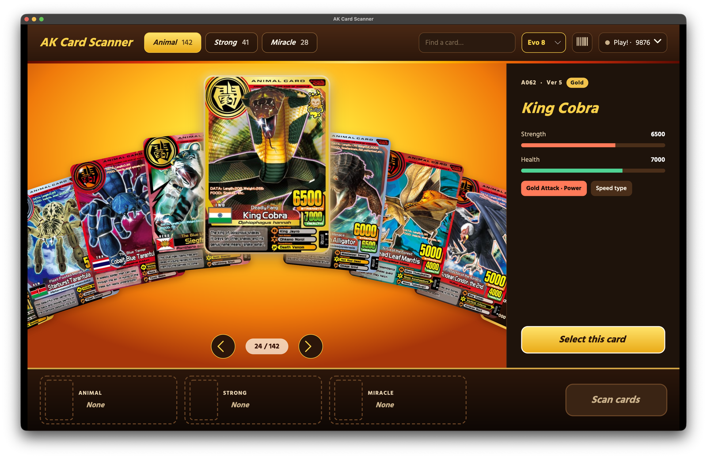

# AK Card Scanner for macOS

A native macOS app for playing **Animal Kaiser** in the [**Play!** emulator](https://github.com/jpd002/Play-). Fan through the cards, pick an Animal, Strong and Miracle card, and press **Scan cards**: the app sends their barcodes to Play!'s Arcade I/O HTTP Server, as if you had swiped them at the cabinet.



*Shown with card art added locally (see [Card art](#card-art)). Card images © Bandai Namco; the app does not include them.*


## About this fork
This is a fork of [**AK Card Scanner**](https://github.com/Gama-Tech/AK-Card-Scanner) by Gama-Tech, a Windows program that sends card barcodes to Play! from dropdown lists. This fork turns it into a Mac app with its own interface:

- **Native macOS**, built with [Avalonia](https://avaloniaui.net/) on .NET 8. Runs on Apple Silicon, and on Intel Macs when built for `osx-x64`.
- **A card fan instead of dropdowns**, styled after Animal Kaiser+, showing each card's rarity and stats.
- **A cleaned-up card list** of about 400 cards, merged from the original lists and the community barcode spreadsheet, with damaged barcodes repaired or removed and one entry per card.

The fork does not ship a Windows build. Gama-Tech's Windows source is still at the repository root, unchanged apart from keeping the Mac code out of its build, so upstream card fixes can be merged in. Windows users should use [the original](https://github.com/Gama-Tech/AK-Card-Scanner/releases/).


## Disclaimer
The app ships no card images, ROMs or other game files. The card list is text: card numbers, names, stats and 8-character barcode strings that are freely available online. The app sends those strings to a port on your own machine, which tools like `curl` can do too.

The screenshot above shows Animal Kaiser card art, © Bandai Namco, which was added locally for illustration. Animal Kaiser is a trademark of Bandai Namco; this project is not affiliated with or endorsed by Bandai Namco.


## Install
You need the [.NET 8 SDK](https://dotnet.microsoft.com/download/dotnet/8.0) (`brew install --cask dotnet-sdk`).

```bash
git clone https://github.com/kbullett/AK-Card-Scanner.git
cd AK-Card-Scanner/macOS
./build-app.sh            # Apple Silicon (osx-arm64)
./build-app.sh osx-x64    # Intel Macs
```

This writes `macOS/dist/AK Card Scanner.app`, which is self-contained (no .NET runtime needed to run it) and ad-hoc signed. Drag it into `/Applications`.

If you copy the app onto a Mac from somewhere else, sign it there before the first launch, because Apple Silicon won't run unsigned code:

```bash
xattr -cr "AK Card Scanner.app" && codesign --force --deep -s - "AK Card Scanner.app"
```

The app isn't notarised. If macOS still refuses to open it, right-click it, choose **Open**, then confirm.


## Set up Play!
1. In Play!, open **Settings → General**.
2. Tick **Enable Arcade I/O HTTP Server**, then restart Play!.
3. In AK Card Scanner, click **Play! · 9876** in the top right, check the port matches Play!'s (9876 by default), and press **Test connection**. The dot turns green when Play! answers.


## Using the app

| To | Do this |
|---|---|
| Switch pile | Click **Animal**, **Strong** or **Miracle**, or press `1`, `2`, `3` |
| Fan through cards | `←` `→`, the arrow buttons, or click a card at the side. The fan wraps round at the ends |
| Select or deselect a card | `Space` or `Return`, click the centre card, or **Select this card** |
| Scan | **Scan cards** sends what's in your hand |
| Find a card | Type a name or number in **Find a card** |
| Limit to a game version | Pick it from the version dropdown |
| Enter a barcode by hand | The barcode button in the top bar |

**Your hand** is the three slots at the bottom: one Animal, one Strong and one Miracle card. Pick one, two or all three. Selecting another card from the same pile swaps it in, and each slot has a × to clear it.

**Scan cards** sends the picked cards in the order the game expects: the Animal card first, then a 4-second wait while the game plays its animation, then the Strong card, and the Miracle card a second later. If Play! can't be reached, the app says so and stops.

**Game version** limits the piles to cards released up to that version. Only cards whose English release is known are included once a version is chosen; *All versions* shows everything.

**Enter a barcode** sends any code you type. It also works with a USB barcode scanner that types like a keyboard: click in the box and scan.

The window keeps its shape and scales to whatever size you make it. The port and game version are remembered between launches.


## Card data
The cards are in [`macOS/CardData/cards.json`](macOS/CardData/cards.json), one entry per barcode, with the card's pile, number, name, rarity, English release version and, for Version 1 cards, stats. Where a card has several printings (for example a Gold original and a later reissue), the app shows it once and sends the best printing available in the chosen version.

The list comes only from the community [**Barcode List**](https://docs.google.com/spreadsheets/d/1CbBiaGXh8Kiq20VubqkGdwByh6mY6jTwFGv_XPnkyVM) spreadsheet. Each barcode takes its version from the first version tab it appears on; the three export tabs add barcodes missing from the version tabs. The Japanese Animal Kaiser+ tabs are left out, because their barcodes are for a different game. Rows without a card number or with a damaged barcode are skipped.

To rebuild after the spreadsheet changes, download it as text (File > Download, one CSV block per tab, each headed `## Sheet name: <tab>`) and run:

```
python3 macOS/CardData/from_sheet.py <downloaded file> macOS/CardData/cards.json
```

To use your own list without rebuilding, put a `cards.json` in the same format at `~/Library/Application Support/AKCardScanner/cards.json`.

### Card art
The app ships no card images. To show real card art, put images in the folder below. Name each one after the card: the pile letter, a hyphen, then the name in lower case without spaces or punctuation, for example `A-greatwhiteshark.jpg` or `S-virtuousskies.png`. Images named by card number, such as `A002.jpg`, also work, but some numbers are shared by two cards. JPEG, PNG and WebP are supported.

```
~/Library/Application Support/AKCardScanner/CardArt/
```

then restart the app. Cards without an image keep their drawn frame.


## Repository layout
| Path | What |
|---|---|
| `macOS/` | The Mac app: source, card data, fonts and `build-app.sh` |
| `docs/` | README images |
| repository root | Gama-Tech's original Windows source, kept for merging upstream changes |


## AK Barcode Preservation Project
The barcodes come from the community-run AK barcode preservation project: [**Barcode List**](https://docs.google.com/spreadsheets/d/1CbBiaGXh8Kiq20VubqkGdwByh6mY6jTwFGv_XPnkyVM). To submit missing cards, join the [**Unofficial Community Discord Server**](https://discord.gg/kaiser-community-1006111395424768000).


## Licence
GPL-3.0, as upstream. See [`LICENSE`](LICENSE). The bundled Hind Siliguri font is under the SIL Open Font License ([`macOS/Assets/Fonts/OFL.txt`](macOS/Assets/Fonts/OFL.txt)).
